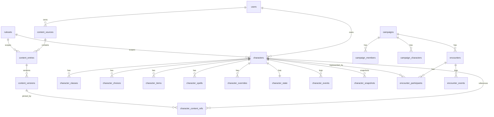

# Data Model

Principle: relational tables for identity, ownership, relationships and runtime state; schema-validated JSONB with a `schemaVersion` for extensible definitions and content-keyed maps; projection tables for search. A character sheet is many rows, never one document.

Conventions: primary keys are UUIDv7 generated by the application; `created_at`/`updated_at` are `timestamptz`; soft deletes use `deleted_at`; every JSONB column has a Zod schema in `content-schema` or the owning server module and carries `schemaVersion` where its shape may evolve.

## 1. Identity and access

Authentication is Better Auth (ADR-0024) on tables we own. The Drizzle object keys `user`, `session`, `account` and `verification` are the model names Better Auth expects; the SQL names below follow our conventions.

| Table           | Columns                                                                                                                                                                                                                                                                                           |
| --------------- | ------------------------------------------------------------------------------------------------------------------------------------------------------------------------------------------------------------------------------------------------------------------------------------------------- |
| `users`         | id text pk, name (display name), email (unique; synthetic `<username>@scriptorium.local` when the user has none, never used for delivery), email_verified, image, created_at, updated_at, username (unique), display_username, role `admin\|user` (default user), banned, ban_reason, ban_expires |
| `sessions`      | id, expires_at, token (unique), created_at, updated_at, ip_address, user_agent, user_id → users (cascade), impersonated_by                                                                                                                                                                        |
| `accounts`      | id, account_id, provider_id (`credential` for passwords), user_id → users (cascade), access/refresh/id tokens and expiries, scope, password (scrypt hash), created_at, updated_at                                                                                                                 |
| `verifications` | id, identifier, value, expires_at, created_at, updated_at                                                                                                                                                                                                                                         |
| `invites`       | id uuid, code_hash (sha256, unique), role, note, created_by → users (set null), expires_at, max_uses, uses, revoked_at, created_at                                                                                                                                                                |
| `audit_log`     | id uuid, actor_id → users (set null), action, target_type, target_id, metadata jsonb, ip, created_at                                                                                                                                                                                              |
| `app_settings`  | key pk, value jsonb, updated_at. Keys: `instance_name`. Setup is complete once any user exists.                                                                                                                                                                                                   |

Registration rule, enforced in the user-creation database hook rather than the UI: the first account ever created becomes `admin` (the setup wizard); afterwards an invite code is required unless an administrator creates the account through the admin API. Invite uses are reserved atomically (`uses < max_uses`, not revoked, not expired) before the user row is written.

## 2. Rulesets and content

| Table                   | Columns                                                                                                                                                                                                                                                                                                             |
| ----------------------- | ------------------------------------------------------------------------------------------------------------------------------------------------------------------------------------------------------------------------------------------------------------------------------------------------------------------- |
| `rulesets`              | id text (e.g. `srd5.1-2014`), name, version, config jsonb (abilities, skills, proficiency bonus table, XP thresholds, slot tables incl. multiclass and pact, point-buy costs, standard array, encounter thresholds and multipliers, rest rules, carrying capacity, `maxLevel` default 20; no table is capped at 20) |
| `content_sources`       | id, slug (unique), name, kind `srd\|user_import\|homebrew`, license, attribution_text, version, publisher, owner_user_id (nullable), visibility `global\|private\|shared`, is_enabled, created_at, updated_at                                                                                                       |
| `content_entries`       | id, uid text (unique, e.g. `srd-5.1:spell:fireball`), source_id, ruleset_id, kind, slug, name, status `draft\|published\|archived`, head_version_id, draft_version_id (nullable), created_by, created_at, updated_at, deleted_at, search_vector tsvector (GIN)                                                      |
| `content_versions`      | id, entry_id, version_no, data jsonb (per-kind schema), effects jsonb, choices jsonb, automation jsonb, change_note, checksum, created_by, created_at. **Immutable.**                                                                                                                                               |
| `content_relations`     | from_entry_id, to_entry_id, relation `grants\|requires\|subclass_of\|list_member\|variant_of` (pk on all three)                                                                                                                                                                                                     |
| `content_tags`          | entry_id, tag (pk on both)                                                                                                                                                                                                                                                                                          |
| `spell_index`           | entry_id pk, level, school, casting_time, ritual, concentration, components, class_uids text[]                                                                                                                                                                                                                      |
| `item_index`            | entry_id pk, item_type, rarity, requires_attunement, cost_cp, weight, properties text[]                                                                                                                                                                                                                             |
| `monster_index`         | entry_id pk, cr numeric, type, size, alignment, environments text[]                                                                                                                                                                                                                                                 |
| `content_source_access` | source_id, campaign_id (nullable), user_id (nullable), access `view\|use`                                                                                                                                                                                                                                           |
| `content_entry_shares`  | entry_id, campaign_id, shared_with jsonb (`all` or user ids)                                                                                                                                                                                                                                                        |

Content kinds: `class, subclass, species, background, feat, feature, spell, spell_list, item, monster, condition, rule, resource`. Projection tables are rebuilt from `data` on publish; other kinds filter via jsonb GIN and tags.

Notes (M2.7): a homebrew source is `kind = homebrew`, `visibility = private`, `owner_user_id` set; `draft_version_id` points at a version row that saves rewrite until `publish` moves `head_version_id` to it (then the next save opens a new draft version). The content repository filters by viewer: global sources for everyone, private sources for their owner and administrators.

Notes (M1.5): entries also carry `search_text` (tsvector + trigram indexes); relations store the target `to_uid` rather than an id so they can point at entries imported later; `content_source_access` and `content_entry_shares` arrive with campaigns (ADR-0027).

## 3. Characters (one aggregate, one revision)

| Table                    | Columns                                                                                                                                                                                                                                                                                                                                                                                                                                                              |
| ------------------------ | -------------------------------------------------------------------------------------------------------------------------------------------------------------------------------------------------------------------------------------------------------------------------------------------------------------------------------------------------------------------------------------------------------------------------------------------------------------------- |
| `characters`             | id, owner_user_id, campaign_id (nullable), ruleset_id, name, portrait_file_id, biography jsonb, ability_method `standard\|point_buy\|manual\|rolled`, base_abilities jsonb, species_entry_id, species_version_id, background_entry_id, background_version_id, xp, hp_mode `fixed\|rolled\|manual`, status `draft\|active\|retired\|dead`, **revision int**, summary jsonb (list-view cache, never authoritative), schema_version, created_at, updated_at, deleted_at |
| `character_classes`      | id, character_id, class_entry_id, class_version_id, subclass_entry_id, subclass_version_id, level, order, hit_dice_rolls int[]                                                                                                                                                                                                                                                                                                                                       |
| `character_choices`      | id, character_id, choice_key text, selected jsonb, source_version_id (unique on character_id + choice_key)                                                                                                                                                                                                                                                                                                                                                           |
| `character_items`        | id, character_id, item_entry_id, item_version_id, custom_item jsonb, quantity, equipped, attuned, charges_current, container_item_id, notes, sort_order                                                                                                                                                                                                                                                                                                              |
| `character_spells`       | id, character_id, spell_entry_id, spell_version_id, origin text (`class:<uid>`, `species`, `feat:<uid>`, `item:<item_row_id>`), known, prepared, always_prepared                                                                                                                                                                                                                                                                                                     |
| `character_overrides`    | id, character_id, stat_path, value jsonb, note (unique on character_id + stat_path)                                                                                                                                                                                                                                                                                                                                                                                  |
| `character_state`        | character_id pk, hp_current, hp_temp, death_saves jsonb, hit_dice_spent jsonb, spell_slots_used jsonb, resources jsonb, conditions jsonb, exhaustion, concentration jsonb, inspiration, currency jsonb `{cp,sp,ep,gp,pp}`, active_effects jsonb, toggles jsonb (`{ [toggleId]: boolean }`), combat jsonb (see below), assumptions jsonb, updated_at                                                                                                                  |
| `character_events`       | id, character_id, actor_user_id, command_type, payload jsonb, before jsonb, after jsonb, revision_after, reversible bool, action_id (nullable), created_at. Append-only.                                                                                                                                                                                                                                                                                             |
| `character_snapshots`    | id, character_id, revision, reason `level_up\|rest\|import\|content_update\|manual`, aggregate jsonb, created_at                                                                                                                                                                                                                                                                                                                                                     |
| `character_content_refs` | character_id, entry_id, version_id, ref_path (pk on character_id + version_id + ref_path)                                                                                                                                                                                                                                                                                                                                                                            |
| `character_notes`        | id, character_id, title, body_md, kind, created_at, updated_at                                                                                                                                                                                                                                                                                                                                                                                                       |
| `command_receipts`       | command_id uuid pk (client-generated), actor_user_id, aggregate_type, aggregate_id, outcome jsonb, created_at (retention 7 days)                                                                                                                                                                                                                                                                                                                                     |
| `rolls`                  | id, requested_by, context jsonb (`{ characterId, ref, ctx, plan }` for action rolls, `{ characterId, kind: "hitDie", die }` for hit dice), expression, results jsonb (`RollInputs` plus the d20 faces and per-packet breakdown text), consumed_by_command_id (nullable, unique; set inside the commit transaction), created_at                                                                                                                                       |
| `files`                  | id, owner_id, kind `portrait\|token\|import`, path, mime, size, sha256, created_at                                                                                                                                                                                                                                                                                                                                                                                   |

`character_state.combat` shape:

```json
{
  "turn": { "encounterId": null, "round": null, "turnId": "local:12", "ownTurn": true },
  "oncePerTurn": { "sneak-attack": "enc:…:3:2" },
  "reaction": { "usedOnTurnId": null },
  "bonusAction": { "usedOnTurnId": null },
  "actions": { "budget": 1, "usedOnTurnId": null }
}
```

Reset rules are specified in `RULES_ENGINE.md` §7.

## 4. Campaigns

| Table                      | Columns                                                                                                                                                                                  |
| -------------------------- | ---------------------------------------------------------------------------------------------------------------------------------------------------------------------------------------- |
| `campaigns`                | id, name, description_md, ruleset_id, dm_user_id, settings jsonb (multiclass allowed, point-buy budget, hp mode, optional rules, dm_can_edit_characters), status, created_at, updated_at |
| `campaign_members`         | campaign_id, user_id, role `dm\|co_dm\|player\|observer`, status `invited\|active\|removed`, joined_at                                                                                   |
| `campaign_invites`         | id, campaign_id, code_hash, created_by, expires_at, max_uses, uses                                                                                                                       |
| `campaign_characters`      | campaign_id, character_id, status `pending\|approved\|retired`, approved_by, approved_at                                                                                                 |
| `campaign_content_sources` | campaign_id, source_id, enabled                                                                                                                                                          |
| `campaign_notes`           | id, campaign_id, author_id, title, body_md, visibility jsonb (`dm`, `all`, or user ids), created_at, updated_at                                                                          |
| `campaign_npcs`            | id, campaign_id, name, monster_entry_id, monster_version_id, statblock_override jsonb, dm_notes_md, player_info jsonb, portrait_file_id                                                  |
| `campaign_awards`          | id, campaign_id, type `xp\|level\|item\|currency`, payload jsonb, recipient_character_ids uuid[], created_by, created_at                                                                 |
| `roll_log`                 | id, campaign_id, character_id, user_id, expression, result jsonb, visibility `public\|dm\|private`, created_at                                                                           |

Notes (M2.8): `campaign_members` carries the DM as a member row (`role = dm`); `campaign_characters` is the approval state and `characters.campaign_id` is set on approval; `campaign_content_sources` widens content visibility to every active member (see the content repository); `campaign_invites` stores a SHA-256 of the join code with expiry and use counts. Notes, NPCs, awards and the roll log arrive with M4.2.

## 5. Encounters (own aggregate)

| Table                    | Columns                                                                                                                                                                                                                                                                                                                                                                                          |
| ------------------------ | ------------------------------------------------------------------------------------------------------------------------------------------------------------------------------------------------------------------------------------------------------------------------------------------------------------------------------------------------------------------------------------------------ |
| `encounters`             | id, campaign_id, name, description_md, dm_notes_md, status `planned\|active\|completed`, difficulty_adjust jsonb, round, turn_index, current_turn_id, version int, started_at, created_at, updated_at                                                                                                                                                                                            |
| `encounter_participants` | id, encounter_id, kind `monster\|character\|npc\|custom`, character_id, entry_id, version_id, npc_id, display_name, initiative numeric, tiebreak, hp_current, hp_max, hp_temp, ac, conditions jsonb, concentration jsonb, combat jsonb (same shape as character_state.combat, for monsters), visible_to_players, defeated, sort_order, instance_data jsonb (legendary/recharge state, overrides) |
| `encounter_events`       | id, encounter_id, actor_user_id, type, payload jsonb, action_id, created_at. Append-only.                                                                                                                                                                                                                                                                                                        |

A participant representing a player character stores no HP of its own; the tracker issues character commands.

Notes (M2.8): `encounter_participants` stores a monster's `entry_uid` and the pinned `version_id`, its hit points, AC, conditions and `combat.turn`; a character participant keeps `character_id` only: its hit points and conditions are read from `character_state` on every encounter response and never copied into the participant row (A1-R, issue #13). Rolled ability scores (A1-R, issue #3) are `rolls` rows with context `{ kind: 'abilityScores', userId }` and results `{ scores[6], breakdowns[6] }`; creation or `setAbilities` consumes the row (`consumed_by_command_id` = the new character's id or the command id), so a roll is used once and only with its own scores. `encounter_events.version_after` orders the log; attack events carry the command id as `action_id`, the same id the character events of that attack carry. Receipts for encounter commands use `command_receipts` with `aggregate_type = encounter`.

## 6. Aggregates, locking and idempotency

- Aggregates: `characters` (revision), `encounters` (version). Commands carry `expectedRevision`; mismatch returns 409 with the current aggregate.
- Lock order inside a transaction: encounter row first, then aggregates by ascending id.
- `command_receipts` makes command retries idempotent; `rolls.consumed_by_command_id` makes roll application single-use.

## 7. JSON governance

Every JSONB column has a Zod schema and, where its shape may evolve, a `schemaVersion`. Migrators run lazily on read and eagerly via the `migrate-json` CLI. SQL changes are drizzle-kit migrations applied at start under an advisory lock. Changes to the content schema bump its version and ship a migrator for stored `content_versions`.

## 8. Entity relationships


